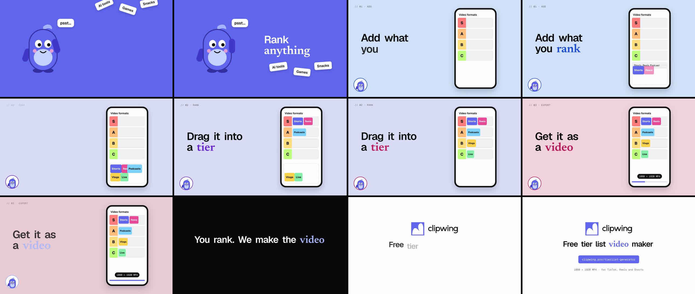

# Mascot Pastel video style

A Claude Code skill for videos in the Mascot Pastel style. Friendly promos with a character: pastel scenes that flow into each other, a serif accent word, a phone with the live product. Claude writes the film as HTML and [HyperFrames](https://hyperframes.heygen.com) renders it to MP4 on your computer.

**Best for:** Consumer and creator apps, playful launches. **Format:** 16:9 or 9:16, 20–45 s.

## What you need

- Claude Code.
- Node.js 18+ and Google Chrome. HyperFrames runs with `npx`, so there's nothing else to install.
- Your logo as SVG and the facts about your product.

## Install

Copy this folder to `~/.claude/skills/video-style-mascot-pastel/` (or `.claude/skills/` in a project) and restart Claude Code.

## Use

Ask Claude, for example:

> Make a Mascot Pastel promo for our mobile app with our mascot: sign up, create, share.

Claude starts from the example film in `template/`, writes your scenes, checks them against the team's video rules (`template/lint-film.mjs`), looks at the frames and renders the MP4.

## What's inside

| Path | What |
| --- | --- |
| `SKILL.md` | The style and the workflow Claude follows |
| `template/` | A finished example film (Tier List Generator promo, 23 s) to start from: `index.html`, the style kit `kit.js`, the shared engine `film-core.js`, fonts and logos |
| `template/lint-film.mjs` | Checks the film against the video rules before rendering |
| `references/` | The video rules and the scene markup reference |

The film comes out silent. Add real sound effects with the [Real SFX](https://clipwing.pro/skills/real-sfx) skill.

Fonts: Geist, Newsreader and Geist Mono, under their open licenses (`template/assets/fonts/LICENSE-*.txt`). The Clipwing logos in `template/assets/` are only there for the example: replace them with your own.

Part of the [Clipwing video styles](https://clipwing.pro/skills/video-styles) collection.
