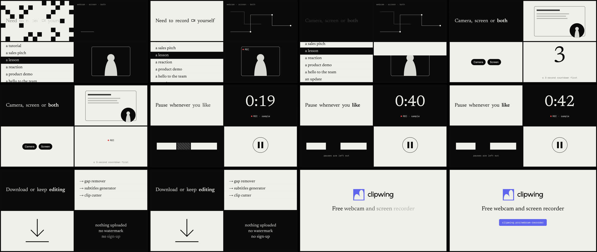

# Mono Grid video style

A Claude Code skill for videos in the Mono Grid style. A black-and-white editorial film in four panels. Each panel has its own rhythm, and the panels change one by one. Claude writes the film as HTML and [HyperFrames](https://hyperframes.heygen.com) renders it to MP4 on your computer.

**Best for:** Calm premium teasers and brand films. **Format:** 16:9, 15–25 s.

## What you need

- Claude Code.
- Node.js 18+ and Google Chrome. HyperFrames runs with `npx`, so there's nothing else to install.
- Your logo as SVG and the facts about your product.

## Install

Copy this folder to `~/.claude/skills/video-style-mono-grid/` (or `.claude/skills/` in a project) and restart Claude Code.

## Use

Ask Claude, for example:

> Make a 20-second Mono Grid teaser for our recorder app, black and white, our colour only on the last button.

Claude starts from the example film in `template/`, writes your scenes, checks them against the team's video rules (`template/lint-film.mjs`), looks at the frames and renders the MP4.

## What's inside

| Path | What |
| --- | --- |
| `SKILL.md` | The style and the workflow Claude follows |
| `template/` | A finished example film (Webcam Recorder promo, 19 s) to start from: `index.html`, the style kit `kit.js`, the shared engine `film-core.js`, fonts and logos |
| `template/lint-film.mjs` | Checks the film against the video rules before rendering |
| `references/` | The video rules and the scene markup reference |

The film comes out silent. Add real sound effects with the [Real SFX](https://clipwing.pro/skills/real-sfx) skill.

Fonts: Newsreader, Geist and Geist Mono, under their open licenses (`template/assets/fonts/LICENSE-*.txt`). The Clipwing logos in `template/assets/` are only there for the example: replace them with your own.

Part of the [Clipwing video styles](https://clipwing.pro/skills/video-styles) collection.
